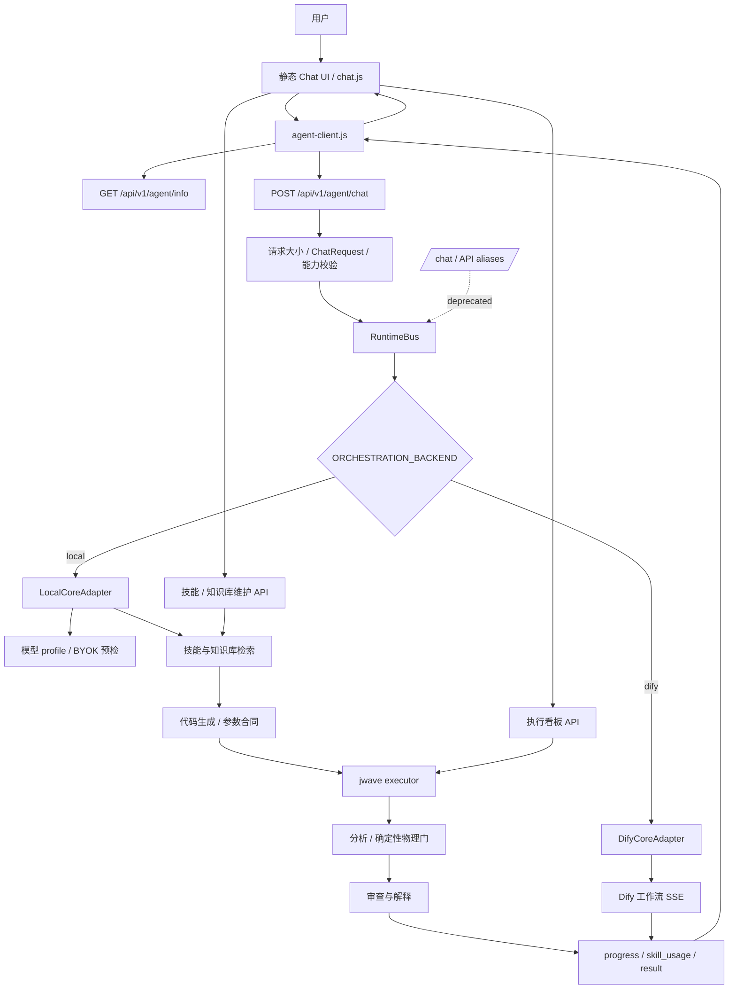

# Agent Backend API v1

本文档定义 AcouAgent 前后端之间的通用后端接口。浏览器或独立前端只需依赖本契约，不需要知道本地编排、Dify、executor、SQLite 或技能库的实现细节。

## 1. 边界与能力

Canonical namespace：

```text
/api/v1/agent/*
```

旧路径 `/chat`、`/api/v1/chat`、`/api/model-profiles`、`/api/byok/session` 和 `/api/model-profiles/test` 仍保留，用于渐进弃用。旧路径继续返回历史裸响应形状，并带：

```text
Deprecation: true
Link: </api/v1/agent/...>; rel="successor-version"
```

后端能力由 `GET /api/v1/agent/info` 发布：

```json
{
  "ok": true,
  "data": {
    "api_version": "v1",
    "backend_id": "local",
    "backend_label": "本地编排",
    "capabilities": {
      "chat": true,
      "streaming": true,
      "model_profiles": true,
      "byok": true,
      "model_preflight": true,
      "skill_usage": true
    }
  }
}
```

- `local` 支持聊天、模型 profile、BYOK 和连接预检。
- `dify` 支持聊天、流式事件和技能提示；模型由 Dify 管理，因此 `model_profiles`、`byok`、`model_preflight` 为 `false`。
- 不具备某项能力时返回 HTTP `501` 和 `capability_not_supported`。
- 未知或不可启动的后端返回 HTTP `503` 和 `backend_unavailable`。

## 2. Chat API

### 请求

`POST /api/v1/agent/chat`

```json
{
  "message": "仿真 2 MHz 点声源",
  "requirement": "上一轮完整需求",
  "session_id": "s1",
  "model_profile": "byok-xxx",
  "stream": true
}
```

字段约束：

| 字段 | 约束 |
|---|---|
| `message` | 非空字符串，最多 65536 UTF-8 字节 |
| `requirement` | 字符串，最多 65536 UTF-8 字节 |
| `session_id` | 字符串，服务端最多保留 24 个字符 |
| `model_profile` | 可省略，最多 64 个字符 |
| `stream` | 严格布尔值；只有 `true` 才启用 NDJSON |
| 请求体 | 最多 128 KiB |

### 非流式响应

```json
{
  "ok": true,
  "data": {
    "event": "result",
    "report": "报告文本",
    "workflow_status": "succeeded",
    "request_id": "uuid",
    "workflow_run_id": "uuid",
    "skill_usage": [],
    "orchestration_backend": "local"
  }
}
```

请求合法但工作流失败仍返回 HTTP `200`，由 `data.workflow_status="error"` 表示。协议错误、认证/后端不可用等使用 HTTP 错误码。

### 流式响应

响应类型：`application/x-ndjson`。每行一个事件，不包在 v1 envelope 中。

```json
{"event":"progress","stage":"本地编排：生成代码","request_id":"uuid","workflow_run_id":"uuid"}
{"event":"skill_usage","skill_usage":{"message":"已使用验证技能","skill_id":"...","version":1},"request_id":"uuid"}
{"event":"result","report":"报告文本","workflow_status":"succeeded","request_id":"uuid","workflow_run_id":"uuid","skill_usage":[],"orchestration_backend":"local"}
```

事件顺序约束：

1. `progress` 可出现 0 到多次。
2. `skill_usage` 可出现 0 到多次。
3. `result` 必须出现且只能出现一次，并且是最后一行。

适配层负责把 Dify 的 `outputs.text` 归一化为 `report`；新前端不应依赖内部 `outputs`。

## 3. 模型管理

### 公开 profile

`GET /api/v1/agent/model-profiles`

```json
{
  "ok": true,
  "data": {
    "default_profile": "fast",
    "byok": {
      "enabled": true,
      "session_ttl_seconds": 43200,
      "private_endpoints_allowed": false
    },
    "profiles": [
      {
        "id": "fast",
        "label": "Fast",
        "provider": "openai-compatible",
        "model": "example-model",
        "configured": true,
        "tasks": ["parameter_extraction"],
        "capabilities": ["chat", "json", "code"]
      }
    ]
  }
}
```

该接口不返回 API Key、环境变量值或可重放密钥。

### 创建 BYOK 会话

`POST /api/v1/agent/model-sessions`

```json
{
  "label": "我的模型",
  "base_url": "https://models.example.com/v1",
  "model": "model-id",
  "api_key": "secret"
}
```

返回：

```json
{
  "ok": true,
  "data": {
    "profile_id": "byok-opaque-handle",
    "label": "我的模型",
    "model": "model-id",
    "expires_in_seconds": 43200
  }
}
```

密钥只保存在当前网关进程内存中；浏览器只保存不透明 `profile_id`。

### 预检与撤销

```text
POST   /api/v1/agent/model-profiles/{profile_id}/test
DELETE /api/v1/agent/model-sessions/{profile_id}
```

预检执行有界模型连接检查，不执行模型返回的代码。撤销不存在的临时会话返回 HTTP `404` 和 `model_session_not_found`。

## 4. 错误契约

v1 错误响应：

```json
{
  "ok": false,
  "error": {
    "code": "invalid_request",
    "message": "message is required",
    "request_id": "uuid"
  }
}
```

常用状态码：

| HTTP | code | 场景 |
|---|---|---|
| 400 | `invalid_request` | JSON、字段或模型 profile 无效 |
| 413 | `request_too_large` | 请求体超过限制 |
| 404 | `model_session_not_found` | 临时模型会话不存在 |
| 501 | `capability_not_supported` | 当前后端不支持该能力 |
| 502 | `workflow_incomplete` / `model_backend_error` | 后端工作流或模型连接失败 |
| 503 | `backend_unavailable` | 后端未注册或不可用 |

错误信息不得包含模型密钥、完整模型响应、执行器内部凭据或 traceback。

## 5. 前端访问与 CORS

默认同源。独立前端通过页面 meta 或客户端构造参数指定 API base：

```html
<meta name="acouagent-api-base" content="https://agent.example/api/v1/agent">
```

跨域来源必须在 `PORTAL_ALLOWED_ORIGINS` 中显式列出，逗号分隔，不能使用通配符：

```dotenv
PORTAL_ALLOWED_ORIGINS=https://frontend.example
```

服务端只允许 `GET`、`POST`、`DELETE`、`OPTIONS` 和 `Accept`、`Content-Type` 请求头，不使用 cookie credentials。默认空值表示仅同源。

本次不新增用户登录体系，部署者继续通过网络边界、CORS 白名单和现有管理员令牌保护服务。

## 6. 新后端接入

1. 实现 `CoreBackend`：
   - `info() -> BackendInfo`
   - `events(ChatRequest) -> AsyncIterator[WorkflowEvent]`
2. 在适配器注册表中登记后端 ID，并让 `ORCHESTRATION_BACKEND` 选择它。
3. 只返回允许的 `progress`、`skill_usage`、`result` 事件；`result` 必须是 terminal event。
4. 若不拥有模型 profile/BYOK，不要在 capabilities 中声明相关能力；不要伪造本地模型。
5. 运行 `tests/unit/test_agent_contracts.py`、`test_agent_api.py` 和全量回归。
6. 前端通过 `GET /info` 自动降级，不需要为每个后端维护分支。

知识库、技能库和看板维护接口不在此 canonical namespace 内，现有 `/skills/api`、`/skills/api/v1` 和 `/dashboard/api/*` 保持不变。

## 7. 全流程图


