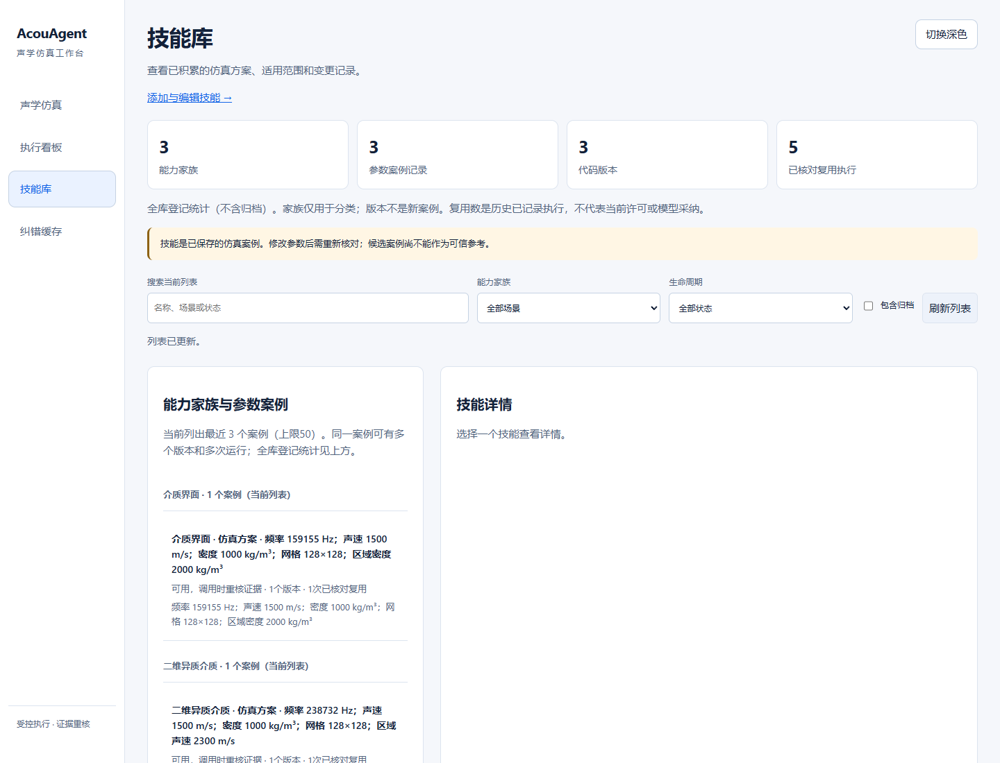
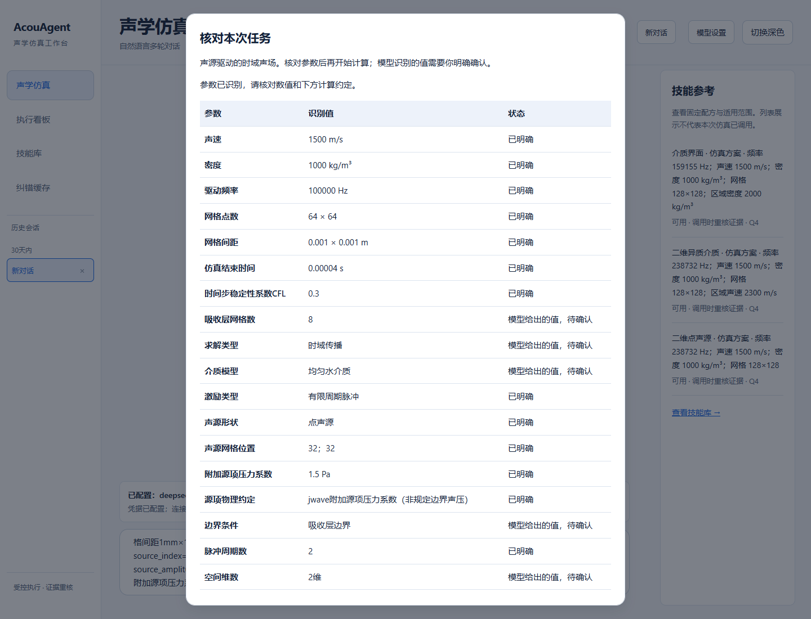
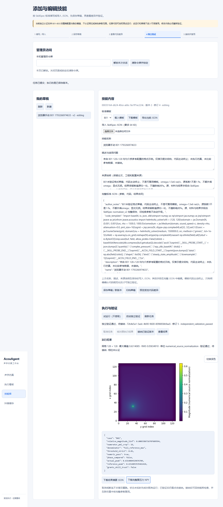
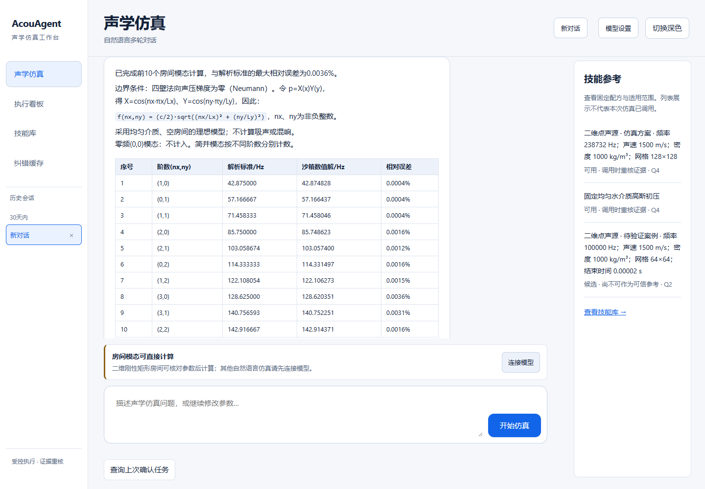
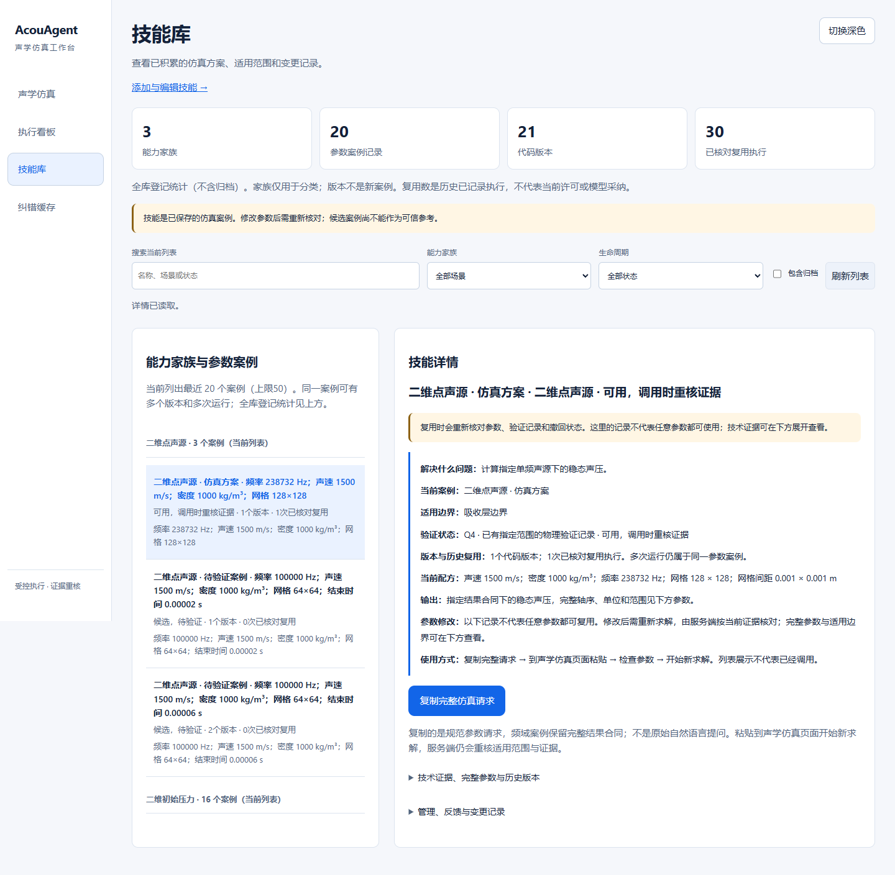

# 技能库与任务识别优化测评

**结论：本轮优化已完成并通过正式浏览器复验。重复运行没有新增相同技能案例；三类问题均完成自动学习和真实复用。参数可在执行前核对，缺项会明确指出。结论限于本次覆盖范围，不代表任意问题或任意改参均已验证。**

## 本轮解决了什么

- 技能库区分“场景家族、参数案例、代码版本、复用执行”，保留不同介质和模态的名称；用途和边界先展示，代码及原始证据折叠。
- LaTeX房间题正确进入模态分析，已给参数不再追问，不要求无关的驱动频率或PML。
- 初压、频域和首批二维时域点源任务可核对来源、单位、缺项与模型建议。确认后冻结条件，重新识别立即作废旧确认；中断可查原任务，不重复提交整项计算。

## 自动学习与复用的实际结果

先在空技能库提交三个完整问题，让系统自行求解、独立验证并接纳；再改变请求格式重新提交相同物理条件。B01额外重复两次。每次复用都有新的执行编号，不是返回旧图片。

| 实例 | 独立标准 | 幅值相对最大误差 | 门限 | 结果 |
|---|---|---:|---:|---|
| B01 均匀水介质点源 | 作者k-Wave参考场 | 0.03387% | <1% | 自动接纳；3次新求解复用 |
| B02 声速2300m/s的局部区域 | 作者k-Wave参考场 | 0.03234% | <1% | 自动接纳；1次新求解复用 |
| B03 密度2000kg/m³的半空间 | 作者k-Wave参考场 | 1.93895% | <3% | 自动接纳；1次新求解复用 |

三题均使用128×128网格、1mm间距、16层PML，保留完整复压力结果；精确源位置、频率和材料范围见仓库B01–B03标准实例。标准数据来自[ucl-bug/jwave-data固定提交](https://github.com/ucl-bug/jwave-data/tree/600e50c8b4ac71f0bc344098320a1e30b80ade00/tests/kwave_data)，MAT与转换后的NPY都核对冻结摘要，参考答案不交给模型或执行器。另用独立NumPy计算重核完整结果；误差定义为去掉16格边缘后的幅值差最大值，除以完整参考场幅值最大值。这里只认证幅值，没有认证相位。

最终仍为**3个参数案例、3个代码版本、5次已核对复用**。再分别改变频率、材料声速和源位置，产品完成新的Q2受控求解，但没有沿用Q4、没有自动接纳。这证明认证范围没有被错误扩大，也说明当前还未证明任意改参的泛化学习。

**速度和准确率：**本轮证明已有技能能够被真实调用、重新求解并通过标准比较；没有做同模型、有技能/无技能的随机对照，因此不能声称已量化提速或提高准确率。首次运行Q2、复用Q4反映独立验证证据不同，不等于数值算法本身更准确。

## 参数核对和用户操作

在“声学仿真”输入问题 → 查看核对框 → 补齐明确缺项、核对换算值 → 确认模型建议与计算约定 → 开始计算 → 到看板核对同一执行编号。修改原文须重新识别。时域点源还需声明波形、周期数、源位置及幅度约定，避免代码自行选择。

原题4m×3m刚性房间、声速343m/s的前10模态，受控数值解与独立解析式最大相对误差0.0036%；等价单位、零模态和简并阶数均核对。标准依据为[MathWorks房间模态解析对照](https://www.mathworks.com/help/audio/ug/find-room-modes-with-finite-element-analysis.html)的二维分离变量特化；尺寸是用户原题，并非文献原样数据。

手动添加：技能库 → 添加与编辑 → 导入标准JSON → 保存 → 查看并确认受控代码差异 → 验证 → 查看标准对比结果 → 接纳。编辑新版本不会继承旧验证，管理员凭据不持久存进浏览器。

## 验收范围与版本

候选运行源码为`2866f5d`：真实房间浏览器33项、时域确认17项、多类预览27项、手动添加22项；三类学习正例及改参边界均有独立运行证据。GitHub全套2254通过、8项环境条件跳过；涉及Node的展示测试已在本机实际执行。干净安装通过。

测试中发现的隐藏波形假设、模型参数别名和诊断误报均先记录再修复。验收器遗漏手动worker、边界测试与其他测试并行导致全局计数变化，也保留失败记录并单独复测，未把失败轮次算成通过。

新参数确认与房间模态入口默认关闭，须显式启用；自动学习扩展仍要求安装独立参考与实际运行时核对，见[启用指南](../../skills-next/ENABLE_SKILLS.md)。

PR [#40](https://github.com/MWXrookie/AcouAgent/pull/40)已合入main（`87b1dd7`），正式网关健康，181个运行文件与main一致。原有三库23张表的原始内容核对保留，原852条执行与29条缓存未丢失；新增的部署测试记录独立保留。精确回退到升级前镜像、再升级均通过，executor容器、启动时间及安全限制未变。

正式环境已准备并核对三项独立参考和实际运行时，开启自动学习、手动添加及两个新确认入口。正式HTTP实跑再次证明首次学习Q2、独立接纳、新run复用Q4；原LaTeX房间题求解、同run看板和重放拒绝也通过。测试临时模型已撤销。新安装的扩展开关仍按启用指南显式准备，不能只拉代码便假定扩展已开启。

### 最后一项正式页面复验已通过

恢复访问通道后，在正式服务完成**33项房间模态全流程检查、25项只读页面及手机布局检查，共58项通过**，浏览器脚本错误0。覆盖原LaTeX题、等价单位、零模态与简并阶数、参数冲突阻断、确认重放拒绝、刷新恢复，以及同一run的看板；页面检查覆盖模型设置、技能详情、添加入口、看板、缓存、明暗主题及手机导航。

这两张为正式服务截图；前面的三组学习对照与手动添加截图来自独立测试环境。正式库已有历史案例，所以正式页面的全库统计不等于空测试库的3案例/3版本，不能混为同一组统计。

最终正式历史为859次执行：原852次完整保留，另有本轮部署及正式浏览器验收新增7次，均可追溯；缓存仍29条，原三库23张表的原始行摘要再次核对通过。本次仅补验收记录和文档，运行架构未变，不需要重复生成架构图。**本轮阶段0–5在首批支持范围内完成；桌面EXE发布继续暂停。**
