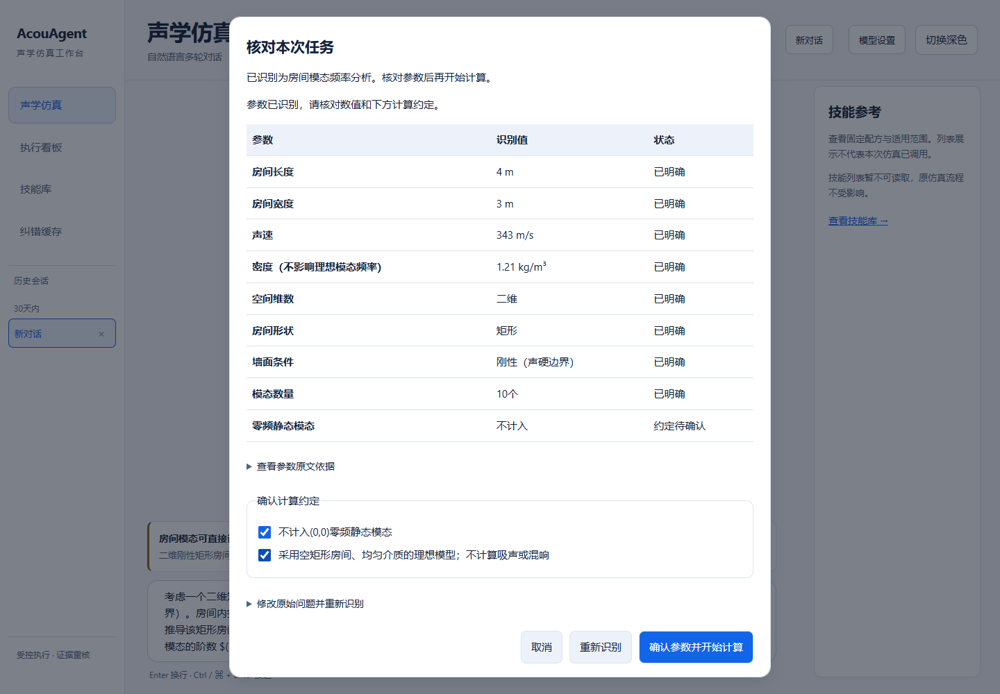
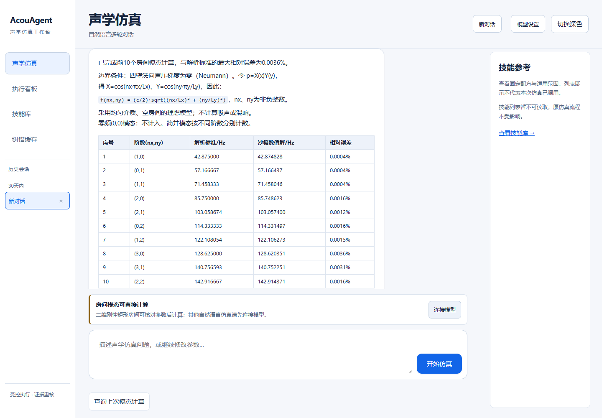

# 房间模态：阶段检查点

**原题已能从浏览器核对参数、在沙箱完成新计算，并与解析标准逐项比较。前10模态最大相对误差为0.0036%。** 这是候选能力验收；正式服务尚未升级，技能学习/复用的完整优化尚未验收。

| 测试 | 结果 |
|---|---|
| 用户原始LaTeX：4m×3m、343m/s、前10模态 | 参数正确；模态阶数与标准一致；最大相对误差0.0036% |
| 改用400cm×3000mm并换提问 | 与原题结果完全一致；产生独立的新执行编号 |
| 3m×3m、前9模态、计入零频 | 零频正确计入；简并模态保留不同阶数；最大相对误差0.0020% |
| 缺参、长度冲突、未接受约定、旧确认重放 | 阻断执行；不产生学习记录 |
| 刷新后查询、并发、超时及重启边界 | 查询原任务；不自动重复派发；未确认结果保持待核对 |

标准为刚性壁Neumann边界下的分离变量解：`f=(c/2)·sqrt((nx/Lx)²+(ny/Ly)²)`。依据 [MathWorks](https://www.mathworks.com/help/audio/ug/find-room-modes-with-finite-element-analysis.html) 与 [COMSOL](https://doc.comsol.com/6.4/doc/com.comsol.help.models.mph.eigenmodes_of_room/eigenmodes_of_room.html)。4m×3m来自用户原题；没有将自行计算的数值说成论文原表。

沙箱用有限体积Neumann矩阵求本征值，独立对照解析标准，并以半分辨率核查收敛；不是有限元。所列模态之外也核对有界阶数网格，全部校验阶数最大误差0.0402%，门限0.1%。只适用于二维、空矩形、四壁刚性、均匀介质，首批最多20个模态。

最终浏览器33项检查、3次新求解及110项相关回归通过；另有5组真实沙箱探针。测试使用本机隔离网关，经SSH测试传输调用原沙箱，测试账本与历史独立；没有模型调用或生产数据库写入。默认 `ROOM_MODAL_ENABLED=false`，尚未合并部署；此新类别尚未自动学习，也未套用Helmholtz压力场质量等级。

接下来继续通用任务参数合同、技能家族/案例整理、去重和完整发布验收。这个检查点不能证明全部功能无缺陷，也不能证明技能已提升速度或准确率。
