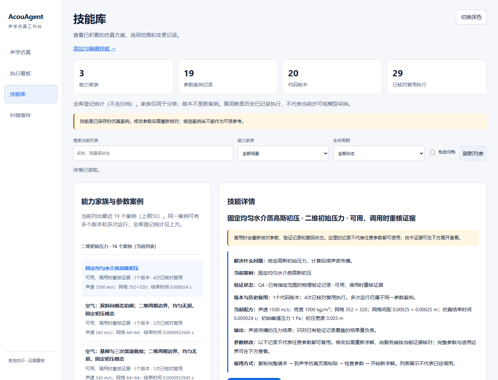

# 技能库可读性：阶段检查点

**重复运行不再被含混地称为“新技能”。界面分开显示家族、案例、版本和历史已核对复用执行记录。** 这是候选界面，尚未部署到正式服务。

正式库的在线备份副本中，非归档范围为：**3个能力家族、19个参数案例、20个代码版本、29条历史已核对复用执行记录**；含归档则有20个案例、21个版本。15种周期配方属于不同参数案例，不能称为15种通用能力；两条候选的结束时间也不同，应分别保留。

现在可以先看到“解决什么问题、适用条件、输入输出、如何使用”；代码、哈希和原始证明默认折叠。列表与聊天侧栏保留介质、模态和必要参数，避免不同案例显示同名。复制按钮明确复制完整规范请求，不能把它说成原始自然语言提问。

| 检查 | 结果 |
|---|---|
| 同一来源重复记录10次 | 仍为1个案例、1个版本 |
| 相同参数、相同代码的10次新来源 | 仍为1个案例、1个版本；观察不冒充执行 |
| 并发记录同一案例 | 只形成1个案例 |
| 相同参数改变代码 / 改变参数 | 前者增加版本；后者增加案例 |
| 实际副本、桌面/手机、筛选、详情与聊天栏 | 33项通过，副本文件SHA256未变 |

122项相关回归通过；Linux执行关联计数由CI继续检查。测试没有改正式数据库，也没有删除、合并或重新认证旧记录。历史复用次数不代表当前复用许可、模型实际采纳，或未来性能一定提升。通用任务参数确认及最终完整发布验收继续推进。
